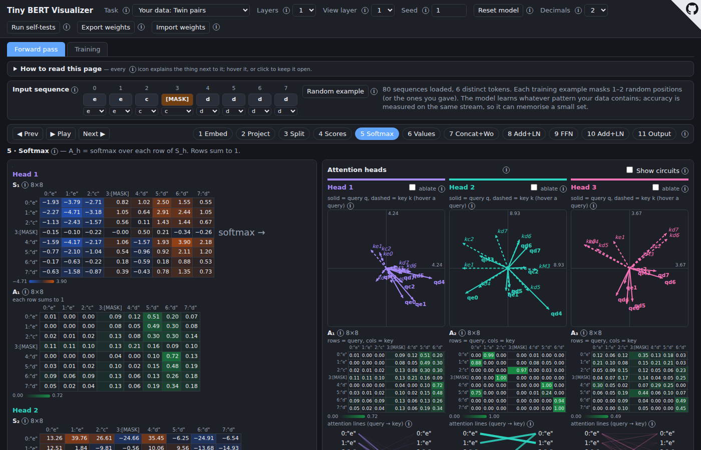

# Tiny BERT Visualizer

**Watch a tiny BERT learn, with every number visible.** A deliberately tiny encoder (6 numbers per token, 3 attention heads) runs and trains in your browser, so you can follow attention from the first random guess to a pattern you can see.

> [!IMPORTANT]
> **All code here was written by an LLM (Claude Code), directed by a human.**
>
> For a flavour of the conversations, open **How it was made** at the top of the page.

### [▶ Open the live demo](https://nephorion.github.io/picobert/)

**☕ Support this project:** [ko-fi.com/museofnephorion](https://ko-fi.com/museofnephorion)

## Three things to try

1. **Take the tour** (top bar). Eight short steps: the puzzle, an untrained guess, training it yourself, and the head that solves it.
2. **Train it and replay it.** Press **Step ×100** a few times, open the **Training** tab and drag the **Replay** slider to watch attention form.
3. **Break it.** Drag a weight in a dashed **↕ drag to edit** grid and watch the loss and attention change.

The puzzle it starts on is **Twin pairs**: every letter is written twice (`c c a a f f b b`), one is hidden, and the only clue is its partner, so an attention head has to find it.

## What's on the page

- **Forward pass tab:** step through the 11 stages of one pass. Hover any computed number to see its arithmetic. Each head shows query and key arrows, its attention grid and lines, and can be switched off (ablated).
- **Training tab:** one optimizer step in full (batch, loss, gradients, the Adam arithmetic for any weight), history per weight tensor, and a replay of attention and embeddings.
- **ⓘ icons** explain every panel and control.
- **Keyboard:** ← → step through stages. Each weight grid is one Tab stop: arrows move, Enter edits, ↑ ↓ change the value (Shift fine, Page Up/Down coarse), Enter keeps it, Esc undoes it.

It is built for a desktop browser; on a phone it works, but the matrices need sideways scrolling.

## Run it yourself

Open `index.html` in Chrome, Firefox or Edge: no server, no build, works offline.

- **Your own data:** choose *Your data…* in the task menu. One sequence per line, exactly 8 tokens separated by spaces or commas, at most 15 distinct tokens. JSON lines such as `{"tokens":[…],"mask":[2,5]}` fix the hidden positions. Five ready-made sets are included.
- **Check the maths:** *Export weights*, then `uv run reference.py weights.json --ids …` re-runs the forward pass independently in NumPy.
- **Tests:** `node ci/selftest.js` (maths) and `uv run ci/browser_test.py` (the page, in a headless browser; first run `uv run --with playwright==1.65.2 playwright install chromium`). GitHub Actions runs both.

## Learn more

- [Why does seed 5 struggle?](docs/seed5.md) A short lesson in how luck affects training.
- [Measurements](docs/measurements.md): what to expect from each task and example set.
- [spec.md](spec.md): the original brief.

## Usage counts

The hosted copy (nephorion.github.io/picobert) uses [GoatCounter](https://www.goatcounter.com) (no cookies) to count visits and, once per page load, which features are used: tour steps reached, finished or left; Train and Step; the Training tab; dragging or editing a weight; which task or example set; whether your own data was loaded, as text or from a file; and Ko-fi, GitHub and stats link clicks. It also records the referring page, screen width and anything after `?` in the address. Sequences, file names and weights are never sent. The counting script is a pinned version with an integrity check. Opened from disk or hosted elsewhere, the page loads nothing and sends nothing. To leave your own visits out, open the live page once with `#toggle-goatcounter` added to the address.

The numbers are public: **[usage dashboard](https://nephorion.goatcounter.com/?filter=picobert)** (updated hourly).

## License

[MIT](LICENSE) © 2026 Nephorion
